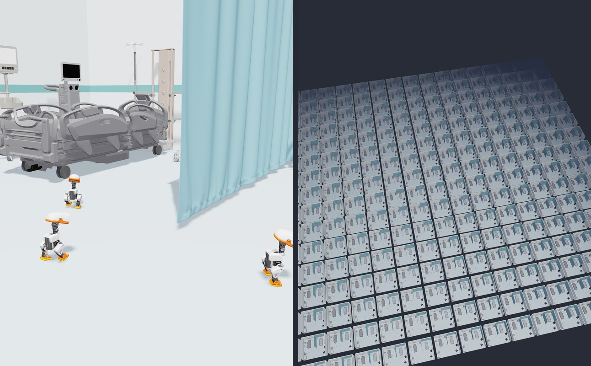

# Simulate robots in an ICU

Build an ICU bay from NVIDIA's open SimReady hospital assets on Hugging Face,
send in three Microducks that walk on a reinforcement-learning policy, then
copy the whole ward hundreds of times and step every copy at once on one
NVIDIA GPU.

```text
SimReady USD assets + Microduck robot + RL policy → N parallel ICU wards → recording (.npz) → video (.mp4)
```

**Reference model:** Pollen Robotics' `velstand` walking policy for
[Microduck](https://github.com/pollen-robotics/microduck), an ONNX network
trained with PPO in mjlab on MuJoCo Warp. Nothing is trained here; the demo
runs the published policy as it is.



Both frames come from one run of this code: 256 wards and 768 Microducks on
one NVIDIA RTX PRO 6000, with 766 ducks still upright after 14 simulated
seconds. The left frame is the middle ward at 5.5 s and the right frame is
the whole grid at 13.6 s, each rendered with `--still-at`.

## See it in action

[Watch the 256-ward pull-back on LinkedIn](https://www.linkedin.com/feed/update/urn:li:activity:7521240619726503938/).

## Why it is useful

- **Physics-ready scenes from a catalog.** Every SimReady asset ships physics
  payloads for Newton, MuJoCo and PhysX behind a USD variant set. You choose a
  variant instead of modeling furniture or authoring colliders.
- **One ward, many worlds.** Newton's `ModelBuilder.replicate()` copies a
  scene into one model, and its MuJoCo Warp solver steps every copy in
  parallel. That is the core shape of a GPU reinforcement-learning
  environment.
- **A borrowed policy, outside its training stack.** You rebuild the exact
  observation from the ONNX metadata and drive every robot in every world with
  one batched inference call.
- **Simulate here, render there.** The simulation records robot poses, so the
  GPU machine never needs a display and any OpenGL machine can make the video.

## Requirements

- Python 3.10 to 3.13.
- About 1.5 GB of disk for `downloads/`, mostly SimReady albedo textures.
- A CPU is enough for one ward. Use an NVIDIA GPU with CUDA for hundreds.
- OpenGL for `--render`. We render in a desktop session; a headless Linux
  server needs a working OpenGL setup such as EGL or Mesa.

## Set up

```bash
cd omniverse/simulate-robots-in-an-icu
python3 -m venv .venv
source .venv/bin/activate
python -m pip install -r requirements.txt
python fetch_assets.py
```

`fetch_assets.py` downloads three things into `downloads/`, pinned to the
revisions of the published run:

- 13 assets from [`nvidia/simready-assets`](https://huggingface.co/datasets/nvidia/simready-assets);
- the Microduck robot description from [`pollen-robotics/microduck_rl`](https://github.com/pollen-robotics/microduck_rl);
- the `velstand.onnx` policy from [`pollen-robotics/microduck-policies`](https://huggingface.co/pollen-robotics/microduck-policies).

It also saves a copy of the policy with a dynamic batch size and checks that
its outputs match the original. On a fresh cloud GPU machine, the install
took 43 s and the downloads 52 s.

## Run it

Simulate one ward with three ducks for 14 seconds:

```bash
python rounds.py
```

Turn the recording into a video:

```bash
python rounds.py --render out/rounds.npz
```

Scale up on an NVIDIA GPU, then render the result with the same command:

```bash
python rounds.py --worlds 256 --device cuda:0 --record out/rounds_256.npz
python rounds.py --render out/rounds_256.npz
```

Useful options:

| Option | Default | What it changes |
| --- | --- | --- |
| `--worlds` | `1` | Copies of the ward simulated in parallel |
| `--ducks` | `3` | Microducks per ward (1 to 3) |
| `--seconds` | `14` | Simulated time |
| `--device` | best available | Warp device, for example `cuda:0` or `cpu` |
| `--still-at` | none | With `--render`, write one PNG at this time instead of a video |
| `--width`, `--height` | `1080`, `1350` | Render size |

## Expected output

`python rounds.py` prints the model size and an upright count every simulated
second, then writes `out/rounds.npz` (robot poses at 25 fps) and
`out/rounds.json` (the summary). The first run also compiles Warp's kernels,
which takes about a minute; later runs reuse the cache. Newton prints a few
`UserWarning` lines while it imports the USD files and sizes its contact
buffers; they are expected.

```text
[build] device=cpu (arm) worlds=1 ducks=3 bodies=45 shapes=496 build_s=41.4
[sim] {'t': 0.02, 'upright': 3, 'of': 3} wall_s=45.4
[sim] {'t': 1.02, 'upright': 3, 'of': 3} wall_s=47.6
...
[sim] {'t': 13.02, 'upright': 3, 'of': 3} wall_s=71.3
[done] {"robot": "microduck", "worlds": 1, "ducks_per_ward": 3, "ducks": 3, "device": "cpu (arm)", "sim_seconds": 14.0, "loop_wall_s": 28.4, "upright_at_end": 3, ...}
```

Our runs with this code:

| Wards | Ducks | Device | Wall time for 14 simulated seconds | Upright at the end |
| --- | --- | --- | --- | --- |
| 1 | 3 | CPU | 28 s, plus 41 s to build the scene | 3 of 3 |
| 256 | 768 | NVIDIA RTX PRO 6000 | 636 s, plus 66 s to build | 766 of 768 |
| 1,024 | 3,072 | NVIDIA RTX PRO 6000 | 1,048 s, plus 66 s to build | 3,069 of 3,072 |

The simulation is not real time. Its job is to show many robots in many
copies of a realistic room on a single GPU, not speed. The policy is
evaluated in Python once per control step, so there is room to make it
faster.

`--render` writes `out/rounds.mp4`: a slow push-in on the three ducks in the
middle ward, then a pull-back over every ward.

## How it works

1. **Scene.** `ward.py` opens each SimReady USD with `pxr`, enables the
   `Newton` physics variant and disables the others. It then removes
   `RigidBodyAPI`, so the furniture becomes static colliders instead of welded
   bodies that would overflow the contact buffers at scale.
2. **One ward.** `rounds.py` imports the Microduck MJCF three times, then adds
   the room and the 15 furniture placements. Room and furniture share one
   negative collision group, so they only ever collide with ducks.
3. **Many wards.** `builder.replicate(ward, N)` copies the ward into a single
   model. `SolverMuJoCo` steps all copies together at 500 Hz.
4. **Policy.** At 50 Hz the script builds each duck's 61-value observation:
   angular velocity, gravity direction, joint positions, joint velocities, the
   last action and a velocity command. It runs one batched ONNX call for every
   duck and writes the result as joint position targets.
5. **Where to walk.** A small waypoint controller (`commands()`) turns each
   duck's goal into a forward-speed and yaw-rate command. The RL policy does
   the actual walking.
6. **Check.** The script logs how many trunks are still above 8 cm, and saves
   the poses of every robot body at 25 fps.
7. **Render.** `--render` rebuilds the same model, asserts that it matches
   the recording, plays the poses back through Newton's OpenGL viewer and
   encodes an MP4.

## Make it yours

- **Another room.** Edit `LAYOUT` in `ward.py`. The SimReady catalog has more
  than 2,500 assets, including operating rooms, labs and warehouses.
- **Other routes.** Edit `HERO` and `TARGETS` in `rounds.py`, or replace
  `commands()` with your own planner.
- **Another robot.** Swap `DUCK_XML` and `POLICY`, and rebuild the observation
  your policy expects in `simulate()`.
- **Training.** The replicated model is already the shape of a parallel RL
  environment. Add a reward and a reset, and train your own policy in the
  ward.
- **The shot.** Tune `CAMERA` at the top of `rounds.py`.
- **With a coding agent.** [PROMPT.md](PROMPT.md) has a starter prompt and the
  lessons that saved the most time when this was first built.

## Privacy and limitations

- Everything runs on your machine. The only network traffic is the downloads
  from Hugging Face and GitHub.
- The robot uses the plain position actuators in Pollen's MJCF, which is their
  `--no-bam` mode, not their motor model. The results are simulation only.
- A few ducks can fall in a long run. The upright count reports exactly how
  many.
- The OpenGL viewer draws one flat color per shape, the average of its
  albedo textures. There is no path tracing.
- This is a robotics simulation demo, not a clinical system.

## From the social post to this repository

The video that was posted simulated 256 wards on one NVIDIA RTX PRO 6000
through Hugging Face Jobs, rendered the recording separately, and added a
caption and music. This version keeps the
simulation and the render, and drops the caption, the music and the cloud job
scripts.

## Credits and licenses

- **SimReady assets:** © NVIDIA, [CC BY 4.0](https://creativecommons.org/licenses/by/4.0/),
  from [`nvidia/simready-assets`](https://huggingface.co/datasets/nvidia/simready-assets).
- **Microduck:** © Pollen Robotics. The MJCF files are Apache 2.0. The STL
  meshes are [CC BY-NC-SA 4.0](https://creativecommons.org/licenses/by-nc-sa/4.0/),
  which means non-commercial use only. `fetch_assets.py` downloads them from
  Pollen's repository; this repository does not redistribute them.
- **velstand policy:** © Pollen Robotics, Apache 2.0.
- **[Newton](https://github.com/newton-physics/newton):** built on NVIDIA Warp, Apache 2.0.
- **Hosting:** the SimReady assets and the policy are served from the
  [Hugging Face Hub](https://huggingface.co).
- **This demo's code:** MIT, like the rest of this repository.

Return to the [Omniverse demos](../) or browse the [full catalog](../../CATALOG.md).
